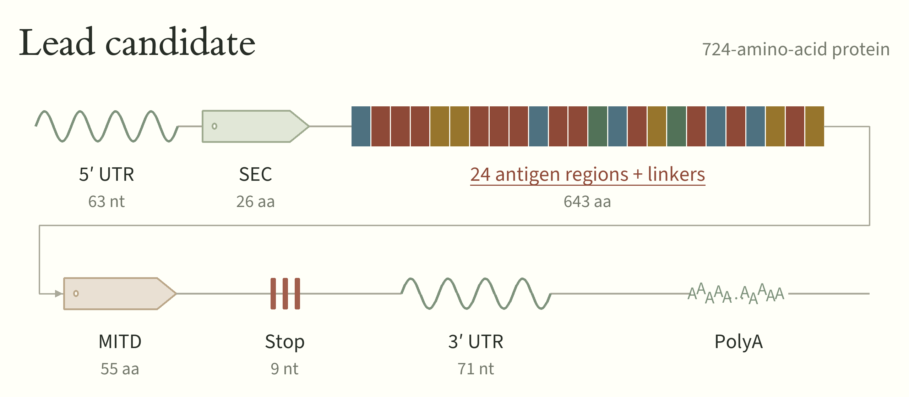

# A personalized mRNA cancer vaccine for Yash

[rnafoundry.com/yash](https://rnafoundry.com/yash), manufactured at the [RNA Foundry](https://rnafoundry.com/).

In January 2025, 32-year-old Yashdeep Bindal was diagnosed with stage IV pancreatic cancer. He had just returned to work after the birth of his daughter, Maya.

At the RNA Foundry, we are developing a personalized cancer vaccine for Yash. We’re sharing his tumour DNA, tumour RNA, matched-normal DNA and vaccine designs so that other researchers can help refine the work.



**[Get the data](data/README.md) · [See the lead design](designs/design-2/README.md) · [Run the code](docs/usage.md) · [Contribute](CONTRIBUTING.md)**

## Data

<!-- datasets:start -->
| Dataset | Files | Size |
|---|---|---|
| Tumour DNA | [BAM](https://yash-data.samarth-3f0.workers.dev/raw/TN25-112103/DNA_TN25-112103.bam) · [index](https://yash-data.samarth-3f0.workers.dev/raw/TN25-112103/DNA_TN25-112103.bam.bai) · [Caris VCF](https://yash-data.samarth-3f0.workers.dev/raw/TN25-112103/DNA_TN25-112103.vcf) | 13.26 GB BAM |
| Tumour RNA | [FASTQ R1](https://yash-data.samarth-3f0.workers.dev/raw/TN25-112103/original/RNA_TN25-112103_S45.R1.fastq.gz) · [FASTQ R2](https://yash-data.samarth-3f0.workers.dev/raw/TN25-112103/original/RNA_TN25-112103_S45.R2.fastq.gz) · [BAM](https://yash-data.samarth-3f0.workers.dev/raw/TN25-112103/RNA_TN25-112103.bam) · [index](https://yash-data.samarth-3f0.workers.dev/raw/TN25-112103/RNA_TN25-112103.bam.bai) | 1.38 GB FASTQ pair; 1.32 GB BAM |
| Matched-normal DNA | [BAM](https://yash-data.samarth-3f0.workers.dev/raw/TN25-112103/normal/normal.recal.bam) · [index](https://yash-data.samarth-3f0.workers.dev/raw/TN25-112103/normal/normal.recal.bam.bai) | 143.29 GB BAM |
| Gene expression | [Supplied expression values](data/expression/vendor-transformed-expression.tsv) | 461.10 kB |
| HLA typing | [Six class-I alleles used in our analyses](data/hla/class-I.tsv) | Small TSV |
| Clinical reports | [Stanford, Caris and Guardant PDFs](#clinical-reports) | Four PDFs |
| Processed data | [Paired variant calls, RNA evidence and candidate tables](data/README.md#processed-data-and-candidate-evidence) | Listed by dataset |
<!-- datasets:end -->

The [data guide](data/README.md) describes each dataset, sample and reference scope. The [file catalog](data/files.tsv) lists locations, sizes and SHA-256 checksums.

## Clinical reports

- [Stanford pathology and IHC](data/reports/stanford-pathology-ihc-2025-01.pdf) — January 2025.
- [Stanford STAMP](data/reports/stanford-stamp-2025-01-31.pdf) — 31 January 2025.
- [Caris tissue profiling](data/reports/caris-tissue-2025-02-22.pdf) — 22 February 2025.
- [Guardant360 liquid biopsy](data/reports/guardant360-2025-10-21.pdf) — 21 October 2025.

## See the lead design

**[Design #2](designs/design-2/README.md) is the lead design**, generated using matched-normal white-blood-cell DNA alongside tumour DNA and RNA. It contains **24 antigen regions in a 724-aa protein**: 12 mutation, 5 splice, 5 CTA/self and 2 fusion regions.

- [Selected antigens](designs/design-2/selection/selected.tsv) · [protein](designs/design-2/construct/protein/cassette.fasta) · [antigen order](designs/design-2/construct/protein/antigen-order.tsv).
- [RNA segment](designs/design-2/construct/mrna/mrna-segments.fasta) · [coding DNA](designs/design-2/construct/mrna/cds.fasta) · [annotated DNA segment](designs/design-2/construct/mrna/template-segments.gb).
- [Methods](designs/design-2/methods.md) · [antigen-by-antigen review](designs/design-2/review/antigen-review.md).

PolyA and any downstream extension are unspecified; nucleotide files contain the known segments. [Design #1](designs/initial/README.md), generated without matched-normal DNA, is retained for comparison.

## Verify and reproduce

With Python 3.11 or 3.12, run from the repository root:

```sh
python3.11 -m venv .venv
source .venv/bin/activate
python -m pip install -e '.[mrna]'
yash-vaccine verify
yash-vaccine reproduce --output work/design-2-replay
```

These commands check and replay the lead design using bundled evidence and recorded predictions. They need no sequencing downloads or cloud account. The [usage guide](docs/usage.md) explains replay and alternative designs; the [pipeline guide](designs/design-2/pipeline/README.md) covers new raw-read processing and inference.

## Make another candidate

Fork the repository, add your work under `designs/your-design/`, and submit a pull request. Include your rationale, data sources, code, commands and useful results. Annotated protein or RNA sequences are welcome; label unspecified components explicitly. An analysis or antigen list can be contributed before a complete construct is assembled.

See [CONTRIBUTING.md](CONTRIBUTING.md). Questions and ideas are welcome as GitHub issues or at yash@rnafoundry.com.

## Other directions to explore

This is one approach to vaccine design. Alternatives could examine MHC class II targets, immunogenicity, antigen trafficking, or linker optimization for processing and presentation.

Shared data are in `data/`, designs in `designs/`, maintained helpers in `src/`, and upstream jobs in `workflow/`. See the [agent guide](AGENTS.md), [reference acquisition guide](docs/external-resources.md), [provenance records](provenance/README.md), [required credits](ACKNOWLEDGEMENTS.md) and [retained-source notices](THIRD_PARTY_NOTICES.md) for details.
