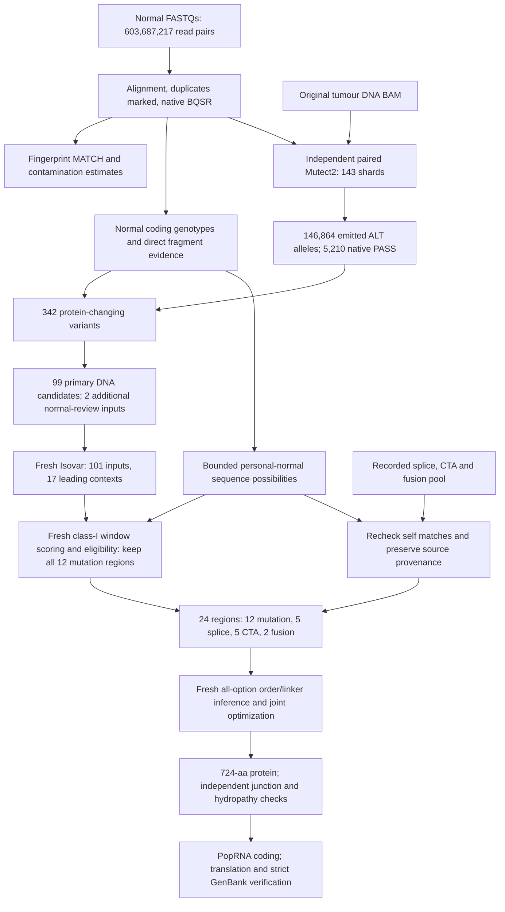

# Design #2: methods and findings

**Design #2 is the lead design.** It uses Yash's matched-normal white-blood-cell
DNA, the original tumour DNA and tumour RNA, and the supplied transformed
expression file. It produces one research design with **24 distinct 25-aa regions
in a 724-aa protein**. Design #1 was generated without matched-normal DNA; its
scientific results are retained for comparison.

## Count flow



## 1. Normal alignment and sample identity

The two compressed input files total 130,524,712,208 bytes and passed source
full-object CRC64NVME and SHA-256 checks on the persistent Modal volume. They
contain 603,687,217 pairs of 150-nt reads; reported Q30 is 96.13%. The QC-only
fastp pass removes no reads or bases. BWA-MEM2 alignment, fixmate, coordinate
sorting and duplicate marking produce an indexed BAM. Primary mapping is 99.99%,
proper pairing 99.31% and marked primary duplicates 2.27%.

The analysis FASTA is the same compatible GRCh38 reference used for this case's
analysis, SHA-256
`c3e61ad6d770db22a6f27fdbcd3dba93d0d80f649018c8887ec803f12ea90450`.
Caris's exact custom-masked alignment reference is unavailable. This is an
explicit reference limitation, not a claim to reproduce its masks.

Native GATK BQSR uses dbSNP/Mills known sites. Training is scattered over primary
nuclear intervals. Application uses disjoint whole-contig groups and a separate
no-coordinate tail, followed by native gathering. A comparison on 16,111 actual
normal records established exact recalibrated-record equivalence with whole-file
application; the full gather preserves all 1,212,214,833 BAM records, including
supplementary and unmapped records. The final calibrated BAM SHA-256 is
`1d864150551f6d47260050c52105c88b7b9f4120d005be33656094767326ce18`.
The sequencer is unknown. Native `--default-platform UNKNOWN` is recorded; the
original header is retained and no instrument model is invented.

Native fingerprinting matches the normal and tumour: LOD 48.887978 against a
required 5, retaining all 933 markers in 240 blocks. The Broad map header is
adapted to the validated shared BAM dictionary after marker-coordinate and
reference-allele checks; marker evidence is not changed. CalculateContamination
estimates 0 normal and 0.000203642 tumour cross-sample contamination. These are
not tumour purity estimates.

## 2. Normal genotypes and explicit normal evidence

Native HaplotypeCaller GVCFs cover primary-nuclear annotated CDS/start/stop
intervals plus 100-bp flanks. Of 76,021,670 target bases, 73,917,616 (97.23%) have
native GQ≥20 and depth≥20, using MIN_DP for reference blocks. This is not a
whole-genome callability percentage. Gathered scatter conflicts are zero.

A focal check combines complete native genotype evidence with unambiguous
fragment-name support from the calibrated BAM: MQ≥20 and focal BQ≥20, at least
20 usable fragments, genotype GQ≥20, target allele not called and fewer than
three ALT fragments for `NORMAL_REFERENCE_SUPPORTED`. Poor coverage, conflicting
reads and incomplete genotypes remain unresolved. A confident target-containing
genotype with alternate support is `PRESENT_IN_NORMAL`, without automatically
equating blood-cell presence with inherited origin.

All **17 original mutation targets** were checked independently, including those
not emitted by fresh paired discovery. Seven are present in normal: KMT2D G3189R,
PARP3 K37Q, CAST I309V, CCNI P285S, PPP2R1A K280N, NRXN2 D203H and DOCK8 G1251R.
All other ten have adequate normal reference evidence and pass the paired DNA
policy. No original target is unresolved because of missing normal coverage.
The [complete audit](review/final/current-17-final-audit.tsv) preserves counts
and the distinction between no exact rediscovery and an actual native rejection.

## 3. Independent paired discovery

GATK **4.6.2.0 Mutect2** takes both BAMs and explicitly names the normal sample.
Discovery covers all 24 primary nuclear chromosomes in 143 parallel shards;
neither Caris variants nor the original 17 targets nominate alleles. The vendor
capture BED is unavailable, so coverage of the calling plan is chromosome-wide.
No panel of normals is supplied.

The calling germline resource is corrected QC-PASS gnomAD v4.1 genomes. All
emitted alleles also receive genome/exome population review. Before native final
filtering, the population prior is the maximum of its recorded native prior and
available QC-PASS global cohort frequencies. Missing or QC-filtered values are
not recoded as measured AF zero; lookup failures stop processing. This emitted-
call prior correction does not redo local assembly. Conflicting duplicate/scatter
measurements are held rather than selected by their most favorable score.

Native sample-wide filtering combines calling statistics, the learned F1R2
orientation model, contamination and allele-fraction segments. It explicitly
uses `FALSE_DISCOVERY_RATE` with a **0.05 model target**, rather than the default
optimal-F-score strategy. This is not an empirically established 5% error rate.
There are 143,552 raw records, 146,864 normalized emitted ALT alleles, **5,210
native-PASS alleles**, and zero scatter conflicts. Exact command and full-
chromosome interval audits are retained in [review/](review/).

## 4. Additional DNA research policy

Of native PASS alleles, 471 overlap coding/splice-boundary annotation and 342
have predicted protein-changing consequences. Primary eligibility requires:

| Rule | Requirement |
|---|---|
| Native site and effective allele filters | PASS |
| Tumour depth / alternate AD | ≥20 / ≥5 |
| Model tumour fraction | ≥5% |
| GERMQ | ≥20 |
| QC-PASS population AF | <0.1% globally and in the recorded maximum-frequency ancestry group, in both queried cohorts; no minimum group size |
| Direct normal evidence | Adequate normal reference support as defined above |
| Context flags | No unresolved sex/ploidy, low-complexity/duplication, population-prior, normal-disagreement or exact Caris FP/low-quality flag |

No extra tumour alternate median MQ/BQ rule is added beyond native GATK filters.
Caris flags are post-discovery review evidence, not nomination or proof of
somatic status. These are explicit research gates, not validated probabilities.
They leave **99 primary variants in 98 genes**. Two additional variants with
unresolved normal evidence enter RNA review as a separate tier, not primary
selection. The exact rules and all rejections are in [paired-policy.json](selection/paired-policy.json)
and [variant-evidence.tsv](exports/variant-evidence.tsv).

## 5. Fresh tumour RNA reconstruction

Isovar **1.57.1**, Varcode **10.16.0** and Pyensembl **2.27.3** use the original
tumour RNA BAM and all 101 RNA-review variants. RNA evidence excludes duplicate,
secondary and supplementary alignments, uses MQ≥20 and NH=1 when present, and
unions mate names as fragments. There is no extra three-fragment requirement.
Repeat-shifted indel representations are explicitly checked for equivalence.

Every input is accounted for: 58 have local coverage but no ALT, 7 lack eligible
local coverage, 17 have ALT without a reconstructed protein, 2 require Isovar
filter review, and **17 yield usable leading protein contexts** from 797 total
hypotheses. All 17 leading contexts are DNA-primary; 16 also have unambiguous
gene attribution. The receipt's field `primary_DNA_and_RNA_eligible=16` includes
that attribution condition; it does not mean one of the 17 failed DNA filtering.
No RNA absence call is inferred from missing coverage.

## 6. Personal-normal self sequences and class-I ranking

The normal coding models combine nearby variants, respecting measured local
phase blocks and enumerating unphased combinations as *possible* self sequences,
with a 4,096-combination cap. Frameshifts retain downstream coding variants.
They include compatible full HLA reference proteins from the earlier measured
two-field typing, not a claim of new full normal HLA typing. There are 112,353
local/HLA sequence possibilities and 8,987 unresolved model records. Exact hits
are conservatively excluded for altered targets; a negative search is scoped
to these models and annotated references, not a complete personal proteome.

MHCflurry **2.3.14**, affinity models **2.3.0**, predicts 604 unique mutation-
overlapping 8–11mers across six alleles: A*01:01, A*33:03, B*08:01, B*15:08,
C*01:02 and C*07:02. All **3,624 predictions are fresh**. None of those mutation
peptides exactly matches the searched reference or patient-normal models.

Vaxrank **3.46.0** scores all eligible fully supported 25-aa windows in the
leading contexts (262 windows). Native per-allele affinity contributions are
summed, with an explicit arithmetic parity check. The best window per context
is selected by that sum, with native centering order breaking ties. Expression
does not choose the 25-aa window. For comparison, the exported tables also
record an expression-weighted score:

`affinity contribution sum × sqrt(supplied gene value × RNA ALT-fragment fraction)`

The fraction divides ALT names by the union of REF/ALT/OTHER names. Gene abundance
comes from the supplied transformed expression file, not raw RNA read counts.
Its calibration as ordinary TPM is not established. This score orders the
mutation comparison tables; it is not a top-N inclusion rule or the order of
antigens in the construct. This run uses affinity, not presentation or
immunogenicity prediction, and no class II.

Primary regions require unambiguous gene assignment, a positive available
expression weight, DNA eligibility, a supported 25-aa window and at least one
non-reference target affinity ≤500 nM. **12 mutation regions pass; all are kept**,
regardless of their expression-weighted rank, without a top-N quota. Expression
therefore remains an eligibility check, but its magnitude and the RNA fraction
do not exclude lower-ranked qualifying mutation regions. Five leading contexts
do not enter: FES has only 15 aa;
SERPINA1 and CTDSP2 have best affinities above 500 nM; H2BC12 lacks supplied
expression even after approved/previous/alias symbol checks; AL358113.1 also lacks
expression and has ambiguous gene attribution. Missing expression is not zero.

## 7. Integrate recorded RNA-source candidates

The pre-existing RNA-only LENS discovery and subsequent coordinate-aware normal
splice screen are reused with recorded checksums, not represented as new raw-RNA
discovery. Eligible splice windows require a complete observed 75-nt sequence,
at least two full-window fragment names, a stop-free verified annotated upstream
frame, recorded strand consistency and ND in both searched normal catalogs.
They are ranked with supplied gene expression, one region per gene. The original
event/region tie-break is retained. Motif disagreement and low support remain
visible; normal DNA does not verify tumour-specific splicing or translation.

For F5, MUC5B, MUC3A and MUC6, the RNA reads show both an unusual splice join
and an extra base change. That base change makes the selected peptides different
from the main reference proteins. [Sequence checks](review/splice-sequence-check.json)
record the reference comparisons and the targeted MUC6 normal-DNA check.
The reference comparison independently reproduces [issue #1](https://github.com/popvax/yash/issues/1).

To repeat these checks with the Ensembl 103 protein FASTA from the
[provider guide](../../docs/external-resources.md), install `pysam==0.23.3` and run:

```sh
python designs/design-2/pipeline/check_splice_sequences.py \
  --reference-proteins /path/to/Homo_sapiens.GRCh38.pep.all.fa.gz \
  --check-normal --output work/splice-sequence-check.json
```

The normal check reads only the indexed MUC6 region over public HTTPS.

Splice/fusion target scoring is rechecked against the new personal-normal models.
Unchanged splice/CTA affinity measurements retain their provenance. Fusion
affinities are freshly re-inferred with original-model parity checks. Five
splice and five CTA/self regions remain unchanged. CTA sequences are intentional
reference self targets; normal DNA does not settle normal expression or exact
patient isoform support. SPATA31A6 has particularly weak local RNA evidence.

Two different breakpoint/translation contexts from CDH1/NRG1 remain. The alternative
frameshift-tail context uses its own exact-breakpoint RNA fraction. The in-frame
driver region has an explicit **508.95-nM inclusion exception** and no borrowed
expression score. Its NAT sequon is a potential glycosylation site; the model
does not assess occupancy. [Every-region review](review/antigen-review.md) records
these distinctions and the known extra-base/normal-tissue annotation issues.

## 8. Joint assembly and fresh independent checks

Every region passes the existing 19-aa Kyte–Doolittle >1.6 exclusion screen.
Patient-supported SEC/MITD sequences remain fixed: the C*01:02 leader plus CS
(26 aa) and the B*15:08-derived terminal domain (55 aa). Supporting evidence stays
in the original allele-evidence directory; it is not relabelled as new normal
typing or measured cleavage.

All 11 recorded linker choices are considered for every directed internal and
terminal option: **6,600 options, 96,352 unique peptides, 578,112 fresh peptide/HLA
predictions**. Native CP-SAT joint path/linker optimization uses one worker and
seed 31. Its four ordered objectives minimize rank≤0.5% rows, minimize rank≤2%
rows, improve the worst junction rank, then minimize added residues. All four
are proven optimal for that finite model. Internal high-hydropathy options are
excluded before optimization.

The final protein has **600 antigen aa + 26 SEC + 55 MITD + 43 linker aa = 724 aa**.
An independent whole-protein junction enumeration matches the pairwise objective;
a separate fresh prediction run verifies all 6,132 selected-junction queries.
Threshold classifications agree. The result still contains one rank≤0.5% row,
26 rank≤2% rows, 24 affinity≤500-nM rows, and zero affinity≤50-nM rows. This is
unwanted-junction binding optimization, not cleavage/presentation optimization.
There are zero unexpected high-hydropathy antigen/linker windows; routing-domain
and boundary overlaps are separately reported, not topology-validated.

## 9. RNA encoding, GenBank and replay

The fixed protein is encoded with the recorded PopRNA implementation, human
codon usage, cutoff 0.10, seed 0 and pinned ViennaRNA **2.7.2**. Existing UTRs,
TAA/TAG/TGA stops and known template context are retained. All hard translation,
motif, codon and annotated component checks pass; strict GenBank round-tripping
preserves all 64 features and 24 antigen identities. Coding GC is 56.08%.
The final paired-bracket heuristic is **21 versus its 14-nt target** after
sequential synonymous repairs; this target is not retained. No repeated 12-nt
pairs remain. No expression/stability benefit is established by these heuristics.

Sense coding is 2,172 nt, or 2,175 nt including the first stop. The known RNA
segment is 2,315 nt and known DNA-context segment 4,256 bp. **PolyA and the
downstream extension are unspecified**; complete molecular lengths, cap chemistry
and modified nucleotides are not assigned. These are not manufacturing-ready
complete RNA/plasmid records.

The exported encoder was replayed locally with pinned dependencies, independently
of Modal, and compared with the recorded outputs. [Verification commands](README.md#verify-or-reproduce),
[native receipts](execution/stage-receipts.json), [worker exits](execution/native-execution.json)
and [artifact checksums/locations](execution/artifacts.json) separate new inference,
reused evidence and offline verification. The [normal-data catalog](../../data/matched-normal/README.md)
provides the final normal alignment, scoped normal genotypes, paired calls and
supporting outputs in R2. Original normal FASTQs remain on the persistent Modal
volume and are excluded from that distribution.
