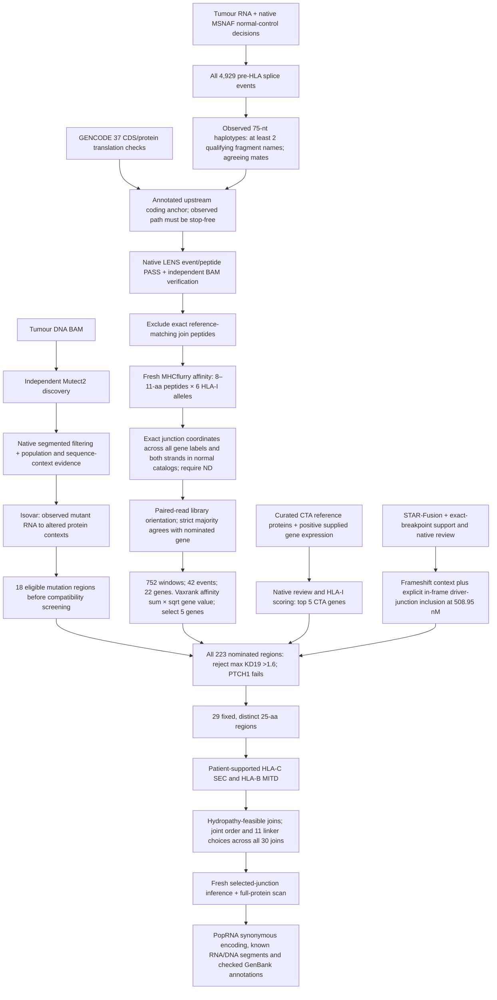

# Initial vaccine design for Yash

This initial design combines **29 distinct 25-aa antigen regions**: **17 mutation,
5 splice from different genes, 5 CTA/self and 2 CDH1::NRG1 fusion regions**. Every
selected splice event is ND in both searched normal-reference catalogs.
Patient-supported HLA-derived SEC/MITD sequences and jointly optimized linkers
form a **852-aa protein**.
PopRNA encodes this fixed protein with a recorded seed and checked synonymous
constraints. PolyA and any downstream extension are unspecified. Nucleotide files contain
known upstream segments, without assigning complete RNA/template lengths.

## Results

- [Selected antigens](selection/selected.tsv) · [Sequences](selection/selected.fasta)
- [Protein](construct/protein/cassette.fasta) · [Order](construct/protein/antigen-order.tsv) · [Coordinates](construct/protein/components.tsv)
- [Known RNA segment](construct/mrna/mrna-segments.fasta) · [Coding DNA](construct/mrna/cds.fasta) · [GenBank](construct/mrna/template-segments.gb)
- [Methods](methods.md) · [Manifest](candidate.json) · [Junction verification](construct/final-check.json) · [Nucleotide checks](construct/mrna/verification.json)
- [Individual antigen review](antigen-review.md) · [Supporting evidence](review/antigen-evidence.json)

## How the design is made



The splice selection is **F5, MUC5B, MUC6, MUC3A, HLA-B**. Its complete
[gene ranking](selection/splice-gene-ranking.tsv) and
[read/score verification](selection/splice-rna-verification.json) remain available.
Native affinity sums are multiplied by the square root of the documented
expression proxy. Splices use gene expression alone; mutations and the ranked
frameshift fusion incorporate their RNA support fractions. The in-frame fusion
is explicitly included without inventing an expression-weighted rank.

All four order/linker objectives are proven optimal in the recorded fixed search
space. The final junction scan has **0 hits at rank ≤0.5%, 33 at rank ≤2%**
and **38 at affinity ≤500 nM**. These are overlapping peptide–HLA binding
counts, not measurements of presentation or T-cell responses. Tumour-only mutation
status remains unconfirmed without matched-normal DNA.

The [hydropathy screen](review/hydrophobicity/README.md) excludes membrane-like
antigen regions and incompatible internal joins. Every full-chain window is
reported, including intentional routing overlaps; this is a heuristic, not
experimental topology validation.

## Reproduce

Install `python -m pip install -e '.[mrna]'`, then run:

```sh
yash-vaccine reproduce
```

This rebuilds and checks selection, protein assembly, junction verification and
RNA encoding using included evidence. It starts no cloud jobs and downloads no
patient reads. To retain outputs, add `--output work/reproduced-initial`.

[Selection](selection/README.md), [assembly](construct/README.md),
[RNA encoding](construct/mrna/README.md) and [upstream execution](../../docs/upstream.md)
explain individual stages. This is one approach; alternatives involving MHC-II,
immunogenicity and presentation-aware linker design are welcome.
